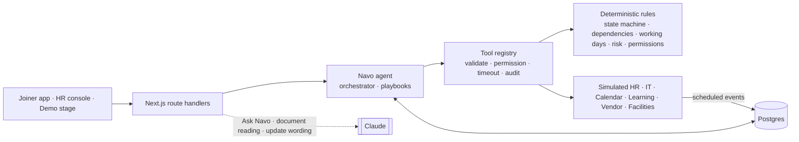

# Navo · AI That Handles Onboarding

[](https://github.com/KumarAnandSingh/new/actions/workflows/ci.yml)

> Navo understands what's next, coordinates the work and steps in when needed.

Navo is an AI onboarding agent. Instead of handing a new joiner another checklist, it **owns the onboarding journey**. It tracks what's done and what's blocked across HR, IT, Facilities, a background-check vendor and the manager. It acts within clear guardrails, explains every action, and only asks the joiner for what genuinely needs them.

| | |
|---|---|
| **Track** | Business Case #2: Employee Onboarding Companion |
| **Live demo** | _Link added after deployment_ |
| **Demo video** | _YouTube link added after recording_ |
| **Technical design** | [`docs/TECHNICAL_DESIGN.md`](docs/TECHNICAL_DESIGN.md) |
| **AI** | Claude (Anthropic API), with a deterministic fallback for every AI feature |

> **Halden is a fictional company.** Every person, document, policy and system in this prototype is synthetic or simulated.


<sub>Thursday, 09:17. Navo's daily check found the Employee ID two days late with zero slack for the laptop. It reminded HR on its own and told Anand he needs to do nothing. Every tool call it made is on the right.</sub>

---

## What Navo does

- **Tracks the whole chain.** 27 onboarding tasks, their owners, deadlines and dependencies, on a working-day calendar (IST, with holidays and lead times).
- **Spots Day-1 risk early.** It knows a laptop needs the Employee ID plus 2 working days, so a late ID on Thursday means Monday is at risk. It acts before anyone notices.
- **Acts within guardrails.**
  - Auto: reminders, IT and HR requests, bookings and a single Day-1 pickup.
  - After 24 hours of silence: escalation.
  - Asks the joiner first: anything sensitive, like a loaner laptop, personal data or benefits.
  - Never: decisions that belong to HR.
- **Explains itself.** Every action has a reason and the policy it relied on (Noticed → Decided → Acted → Planned), for the joiner and for HR.
- **Reads documents.** It extracts fields with Claude vision, verifies them with deterministic rules, and asks about **one unclear date** instead of rejecting the whole document.
- **Answers questions.** Ask Navo uses Claude with read-only tools over the joiner's live state and Halden's policy library. It cites only sections it actually retrieved; otherwise it says it doesn't know.
- **Gives HR a queue of exceptions.** HR gets exceptions, not a spreadsheet of checklists, plus a live feed of what Navo already did.

## See it

| Document reading | Asks before an asset change | Ask Navo, grounded |
|---|---|---|
|  |  |  |

| HR owner console | Impact, computed from the run |
|---|---|
|  |  |

### Watch the 3-minute guided demo

Open the app and press **▶ Play guided demo**. It drives the real engine end to end, from first launch to Day 30, with a caption at each step.

- Keys: **→** next, **←** back, **Space** play or pause, **H** HR view, **B** brief, **Esc** close.
- To explore on your own, use the chapters, the **HR responds / HR silent** switch, **Advance time ▸** and **Inject IT delay**.

| Route | What it is |
|---|---|
| `/` | Demo stage: presenter panel, the joiner's phone, Navo's runtime panel |
| `/phone` | The joiner's app on its own |
| `/hr` | The HR owner console on its own |

---

## Architecture in one picture



- **Deterministic core, LLM at the edges.** Code owns state transitions, dependencies, dates, risk thresholds and permissions. Claude understands and writes language, reads documents and plans read-only lookups, and code verifies everything it returns.
- **Every action goes through the tool registry:** 22 tools, each validated with Zod, permission-checked, timed out and written to an audit row.
- **Event-driven world on a simulated clock.** HR, IT and the others respond later, through scheduled events. *Advance time* runs real events through the real engine.
- **Isolated workspace per visitor**, so judges exploring at the same time never collide.

The full design, with sequence diagrams, the state machine, the data model and deployment, is in [`docs/TECHNICAL_DESIGN.md`](docs/TECHNICAL_DESIGN.md).

## Tech stack

| Layer | Choice |
|---|---|
| App | Next.js 16 (App Router), React 19, TypeScript (strict), CSS Modules |
| AI | Claude via `@anthropic-ai/sdk` (`claude-opus-5-5` by default): tool use, vision, structured output |
| Data | Postgres via Drizzle ORM: Neon in production, embedded PGlite locally and in tests |
| Validation | Zod at every boundary |
| Tests | Vitest (unit and integration, with coverage), Playwright with axe-core (end-to-end and accessibility) |
| CI and hosting | GitHub Actions, Vercel |

---

## Quick start

Requires **Node.js 22+**. There is no database to set up: locally Navo uses an embedded Postgres (PGlite) stored in `.data/`.

```bash
git clone https://github.com/KumarAnandSingh/new.git navo
cd navo
npm ci
cp .env.example .env.local   # optional: add ANTHROPIC_API_KEY for live Claude features
npm run dev                  # http://localhost:3000
```

Without an API key, Navo runs in **offline mode**: every Claude feature falls back to deterministic behaviour, so the demo and the full test suite work without a key. The runtime panel shows which mode is active.

| Variable | Purpose |
|---|---|
| `ANTHROPIC_API_KEY` | Enables live Claude features (server-side only) |
| `NAVO_MODEL` | Claude model, default `claude-opus-5-5` |
| `DATABASE_URL` | Postgres (e.g. Neon). Empty → embedded PGlite |
| `NAVO_DAILY_LLM_CALL_LIMIT` / `NAVO_WORKSPACE_DAILY_LLM_CALL_LIMIT` | Daily Claude call caps (deployment / visitor) |

See [`.env.example`](.env.example) for every option.

## Testing

```bash
npm run lint            # ESLint
npm run typecheck       # tsc --noEmit (strict)
npm test                # unit + integration (Vitest, in-memory Postgres)
npm run test:coverage   # with coverage floors enforced
npm run build
npm run test:e2e        # Playwright against the production build, plus axe accessibility scans
```

- **133 unit and integration tests** and **9 end-to-end tests**. Coverage is about **92% of lines**, and about **99%** for the domain rules.
- Coverage floors are enforced in CI: 85% overall, 95% for `src/domain`.
- The integration suite plays both stories (HR responds, HR silent) through the real engine.
- It also covers the reliability cases: invalid input, tool timeouts, denied actions, conflicting updates, duplicate and failing events, and a missing policy.
- Every Claude edge runs against a scripted fake: an unverified citation, a timeout, an API error, a prompt injection, and the budget cap.

## Deploy

1. Import the repository into **Vercel**. Next.js is detected; no build settings are needed.
2. Add `ANTHROPIC_API_KEY`.
3. Add **Neon Postgres** from Vercel Storage, which sets `DATABASE_URL`. Migrations apply automatically.

Details are in [Deployment](docs/TECHNICAL_DESIGN.md#12-deployment).

## Project structure

```
src/
  domain/         Pure business rules: time, state machine, dependencies, risk, permissions, SLA
  agent/          The onboarding agent: orchestrator, playbooks, actions, tool registry and tools
  services/       Ask Navo, document reading, policy retrieval, events, view models, workspaces
  mock-systems/   Simulated HR, IT, calendar, learning, vendor, facilities
  content/        Synthetic Halden data: people, task template, policies, documents, timeline
  lib/db/         Drizzle schema and database client
  ui/             Phone screens, demo stage, HR console, NavoFace
  app/            Routes and API handlers
tests/            unit/ · integration/ · e2e/
docs/             Technical design, demo video script, specs, design prototypes
video/            The product video: storyboard, composer and voice-over script
scripts/          Migrations, sample documents, screenshots and the video pipeline
```

## Documentation

| Document | What's in it |
|---|---|
| [Technical design](docs/TECHNICAL_DESIGN.md) | Overview and track, architecture and flow diagrams, setup and deployment, code walkthrough, assumptions |
| [Product video](video/README.md) | The voiceless pitch-and-demo video rendered from the real app (`npm run video`), with its [voice-over script](video/VOICEOVER.md) |
| [Demo video script](docs/DEMO_VIDEO_SCRIPT.md) | Shot list and narration for recording a live walkthrough |
| [Submission checklist](docs/SUBMISSION.md) | Each submission requirement and where it is met |
| [Specs](docs/specs/) | Product, agent, architecture, data model, testing, demo scenario |
| [Design prototypes](docs/design/) | The HTML prototypes the UI implements |
| [Build plan](docs/BUILD_PLAN.md) | Phases and key decisions |

---

<sub>Navo is a prototype built for an innovation challenge. Halden, its people, documents, policies and systems are fictional; no real employee data is used. Figures shown in the app come from the simulated run, not production measurement.</sub>
