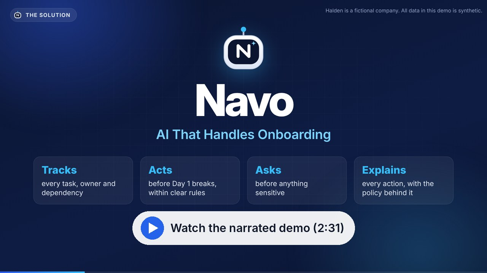
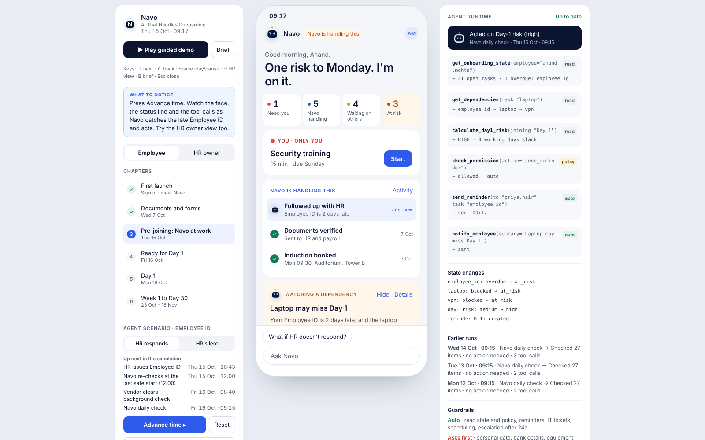
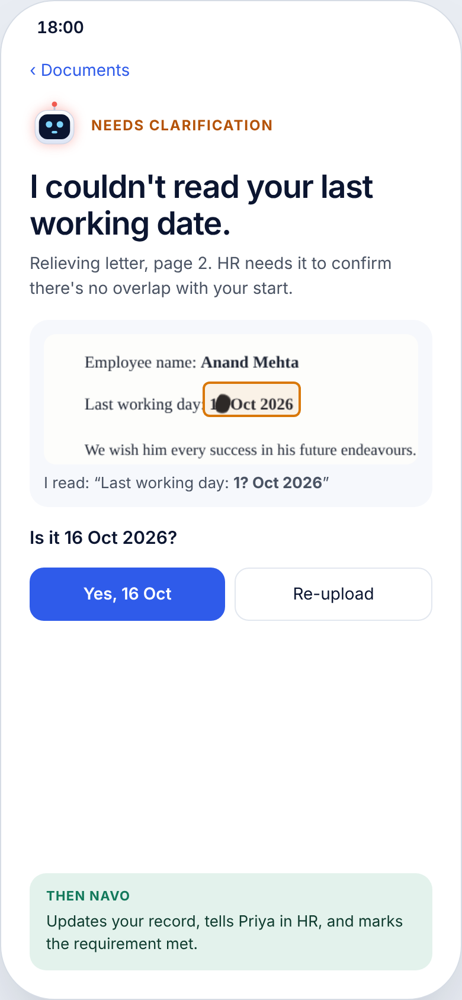
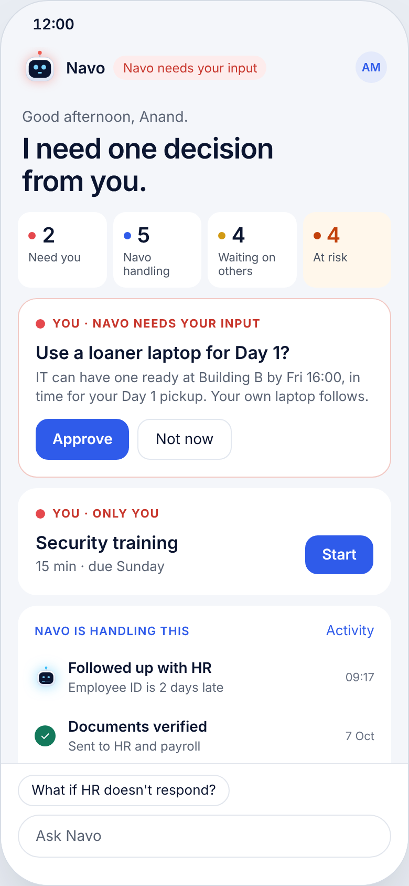
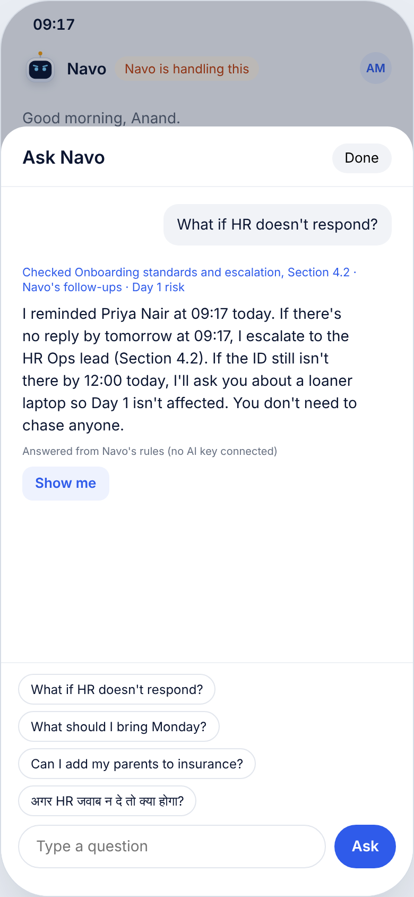
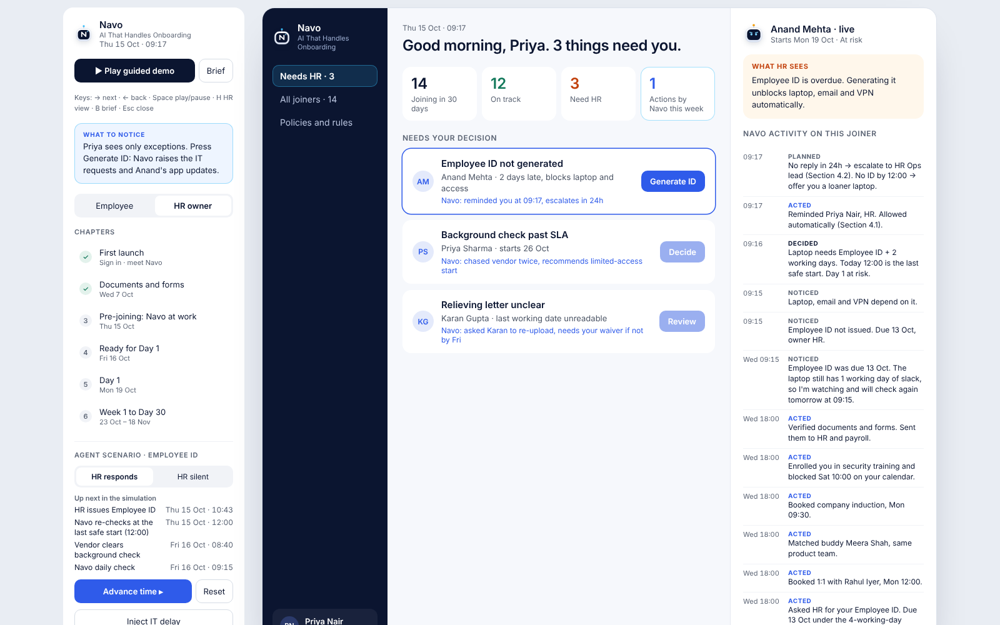
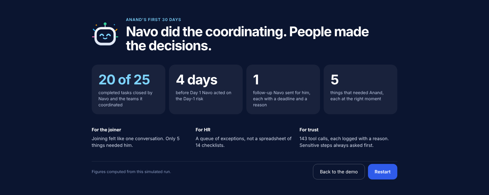
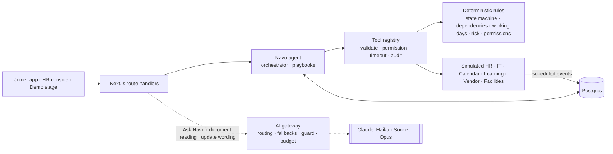

# Navo · AI That Handles Onboarding

[](https://github.com/KumarAnandSingh/new/actions/workflows/ci.yml)

> Navo understands what's next, coordinates the work and steps in when needed.

Navo is an AI onboarding agent. Instead of handing a new joiner another checklist, it **owns the onboarding journey**. It tracks what's done and what's blocked across HR, IT, Facilities, a background-check vendor and the manager. It acts within clear guardrails, explains every action, and only asks the joiner for what genuinely needs them.

| | |
|---|---|
| **Track** | Business Case #2: Employee Onboarding Companion |
| **Live demo** | _Link added after deployment_ |
| **Demo video** | [Narrated demo, 2 min 31 s](docs/media/navo-demo.mp4) (YouTube link added after upload) |
| **Technical design** | [`docs/TECHNICAL_DESIGN.md`](docs/TECHNICAL_DESIGN.md) |
| **AI** | Claude through one gateway: the right-sized model per task, with fallbacks. Offline by default; [bring your own key](#try-it-with-live-claude) to see it live |

> **Halden is a fictional company.** Every person, document, policy and system in this prototype is synthetic or simulated.

[](docs/media/navo-demo.mp4)

<sub>The narrated demo, recorded from the running app: the problem, Navo at work, HR's view, Ask Navo in English and Hindi, policy upload, the cohort radar and the architecture. Select the image to open the video (MP4, 28 MB); captions are in [`navo-demo.srt`](docs/media/navo-demo.srt).</sub>



<sub>Thursday, 09:17. Navo's daily check found the Employee ID two days late with zero slack for the laptop. It reminded HR on its own and told Anand he needs to do nothing. Every tool call it made is on the right.</sub>

---

## What Navo does

- **Tracks the whole chain.** 27 onboarding tasks, their owners, deadlines and dependencies, on a working-day calendar (IST, with holidays and lead times).
- **Spots Day-1 risk early.** It knows a laptop needs the Employee ID plus 2 working days, so a late ID on Thursday means Monday is at risk. It acts before anyone notices.
- **Acts within guardrails.**
  - Auto: reminders, IT and HR requests, bookings and a single Day-1 pickup.
  - After 24 hours of silence: escalation.
  - Asks the joiner first: anything sensitive, like a loaner laptop, personal data or benefits.
  - Never: decisions that belong to HR.
- **Explains itself.** Every action has a reason and the policy it relied on (Noticed → Decided → Acted → Planned), for the joiner and for HR.
- **Reads documents.** It extracts fields with Claude vision, verifies them with deterministic rules, and asks about **one unclear date** instead of rejecting the whole document.
- **Answers questions.** Ask Navo uses Claude with read-only tools over the joiner's live state and Halden's policy library. It cites only sections it actually retrieved; otherwise it says it doesn't know.
- **Gives HR a queue of exceptions.** HR gets exceptions, not a spreadsheet of checklists, plus a live feed of what Navo already did.
- **Sees the whole cohort.** A risk radar runs the real Day-1 risk engine for all 14 joiners and shows which team breaks which Day 1. What-ifs ("IT takes a week longer") show where Day 1 would break before it does.
- **Learns new policies.** HR pastes or uploads a policy. Navo splits it into citable sections, versions it, and cites it in answers straight away.
- **Speaks Hindi.** Ask Navo answers a question asked in Hindi in Hindi, with the same facts and citations.
- **Keeps personal data away from the model.** Aadhaar, PAN, phone, bank and email numbers are masked before chat and status-update text reaches Claude, and restored in the reply.

## See it

| Document reading | Asks before an asset change | Ask Navo, grounded |
|---|---|---|
|  |  |  |

| HR owner console | Impact, computed from the run |
|---|---|
|  |  |

### Watch the 3-minute guided demo

Open the app and press **▶ Play guided demo**. It drives the real engine end to end, from first launch to Day 30, with a caption at each step. To start partway through, click a chapter on the intro screen.

- Keys: **→** next, **←** back, **Space** play or pause, **H** HR view, **B** home, **Esc** close. **← Back to Home**, pinned to the top of every screen, goes back to the intro.
- To explore on your own, use the chapters, the **HR responds / HR silent** switch, **Advance time ▸** and **Inject IT delay**.

| Route | What it is |
|---|---|
| `/` | Demo stage: presenter panel, the joiner's phone, Navo's runtime panel |
| `/phone` | The joiner's app on its own |
| `/hr` | The HR owner console on its own |

---

## Architecture in one picture



- **Deterministic core, LLM at the edges.** Code owns state transitions, dependencies, dates, risk thresholds and permissions. Claude understands and writes language, reads documents and plans read-only lookups, and code verifies everything it returns.
- **Every action goes through the tool registry:** 22 tools, each validated with Zod, permission-checked, timed out and written to an audit row.
- **Event-driven world on a simulated clock.** HR, IT and the others respond later, through scheduled events. *Advance time* runs real events through the real engine.
- **Isolated workspace per visitor**, so judges exploring at the same time never collide.
- **One AI gateway.** It routes each task to the right-sized model and falls back on overload or refusals. It also caches prompts, masks personal numbers, enforces the budget and logs usage and cost. See the [enterprise architecture](docs/ENTERPRISE_ARCHITECTURE.md) for what is built and what is planned.

The full design, with sequence diagrams, the state machine, the data model and deployment, is in [`docs/TECHNICAL_DESIGN.md`](docs/TECHNICAL_DESIGN.md).

## Tech stack

| Layer | Choice |
|---|---|
| App | Next.js 16 (App Router), React 19, TypeScript (strict), CSS Modules |
| AI | Claude via `@anthropic-ai/sdk`: Haiku 5.5 for status updates, Sonnet 5.5 for Ask Navo, Opus 5.5 for documents; tool use, vision, structured output, prompt caching |
| Data | Postgres via Drizzle ORM: Neon in production, embedded PGlite locally and in tests |
| Validation | Zod at every boundary |
| Tests | Vitest (unit, integration, property-based with fast-check, components with Testing Library), Playwright with axe-core, an AI quality benchmark, a load test |
| CI and hosting | GitHub Actions, Vercel |

---

## Quick start

Requires **Node.js 22+**. There is no database to set up: locally Navo uses an embedded Postgres (PGlite) stored in `.data/`.

```bash
git clone https://github.com/KumarAnandSingh/new.git navo
cd navo
npm ci
cp .env.example .env.local   # optional
npm run dev                  # http://localhost:3000
```

Without an API key, Navo runs in **offline mode**: every Claude feature falls back to deterministic behaviour, so the demo and the full test suite work without a key. The runtime panel shows which mode is active.

### Try it with live Claude

Navo never needs the deployment's own key.
1. In the runtime panel, choose **Try it with your own Claude key** and paste an Anthropic API key.
2. **Test connection** checks it for free, using the Models API, and lists the models it can use.
3. **Use this key.** From then on, Ask Navo, document reading and status updates run on Claude. The panel shows each task's model, latency and estimated cost.

The key stays in your browser tab and is gone when you close it. It is sent only with your own requests to Navo's server, which uses it for that request and never stores or logs it. A full demo run costs a few US cents; see the [cost model](docs/COST_MODEL.md).

| Variable | Purpose |
|---|---|
| `ANTHROPIC_API_KEY` | Optional: the deployment's own key, for everyone (daily caps protect it) |
| `NAVO_MODEL`, `NAVO_MODEL_ASK`, `NAVO_MODEL_NARRATE`, `NAVO_MODEL_DOCUMENTS` | Optional: pin a model for every task or for one task |
| `NAVO_BYOK` | `off` stops visitors connecting their own key |
| `DATABASE_URL` | Postgres (e.g. Neon). Empty → embedded PGlite |
| `NAVO_DAILY_LLM_CALL_LIMIT` / `NAVO_WORKSPACE_DAILY_LLM_CALL_LIMIT` | Daily Claude call caps (deployment key / per visitor) |

See [`.env.example`](.env.example) for every option.

## Testing

```bash
npm run lint            # ESLint
npm run typecheck       # tsc --noEmit (strict)
npm test                # unit, integration, property and component tests (Vitest)
npm run test:coverage   # with coverage floors enforced
npm run eval            # AI quality benchmark, offline (add -- --live with a key)
npm run build
npm run test:e2e        # Playwright against the production build, plus axe accessibility scans
npm run load-test -- --base http://localhost:3000 --visitors 50
```

**Results:**
- **264 unit, integration and component tests** pass.
- **13 end-to-end tests** pass on embedded PGlite and on real Postgres.
- Coverage, with the UI included: **90.8% of lines** and **79.8% of branches**. Server code alone: **85.1% of branches**.

**What the suites cover:**
- **Integration:** both stories (HR responds, HR silent) through the real engine. A journey sweep checks every screen at every step for broken copy.
- **Reliability:** invalid input, timeouts, denials, conflicts, duplicate and failing events.
- **Claude edges, against a scripted fake:** unverified citations, refusals, fallbacks between models, prompt injection, the budget, and a visitor key that must never be stored or logged.
- **Property-based (fast-check):** working days, dependency graphs, what-ifs and the personal-data guard.
- **Component:** every phone screen rendered from real engine state.
- **AI benchmark:** 17 Ask questions (3 in Hindi), 3 documents and 6 status updates, graded by code. 16 of 17 Ask cases pass offline; the miss is a deliberate paraphrase. See [AI quality](docs/AI_QUALITY.md).
- **Load test:** 50 simultaneous visitors on Postgres, 350 requests, 0 errors. See [load test](docs/LOAD_TEST.md).

CI runs lint, typecheck, coverage floors, the AI benchmark, a dependency audit, the end-to-end suite on PGlite and on Postgres, and the load test.

## Deploy

1. Import the repository into **Vercel**. Next.js is detected; no build settings are needed.
2. Add **Neon Postgres** from Vercel Storage, which sets `DATABASE_URL`. Migrations apply automatically.
3. No API key is needed: the demo runs offline, and visitors can bring their own key. Add `ANTHROPIC_API_KEY` only to run live for everyone.

Details are in [Deployment](docs/TECHNICAL_DESIGN.md#12-deployment).

## Project structure

```
src/
  domain/         Pure business rules: time, state machine, dependencies, risk, permissions, SLA
  agent/          The onboarding agent: event routing, handlers, reconcile loop, playbooks, actions, tools
  services/       AI gateway, Ask Navo, document reading, policy retrieval and upload, cohort radar,
                  events, view models, workspaces
  eval/           The AI quality benchmark
  mock-systems/   Simulated HR, IT, calendar, learning, vendor, facilities
  content/        Synthetic Halden data: people, task template, policies, documents, timeline
  lib/db/         Drizzle schema and database client
  ui/             Phone screens, demo stage, HR console, AI panel, NavoFace
  app/            Routes and API handlers
tests/            unit/ · integration/ · components/ · e2e/
docs/             Technical design, enterprise architecture, security, cost, API, ADRs, specs
video/            The product video: storyboard, composer and voice-over script
scripts/          Migrations, benchmark, load test, cost model, screenshots and the video pipeline
```

## Documentation

| Document | What's in it |
|---|---|
| [Technical design](docs/TECHNICAL_DESIGN.md) | Overview and track, architecture and flow diagrams, setup and deployment, code walkthrough, assumptions |
| [Enterprise architecture](docs/ENTERPRISE_ARCHITECTURE.md) | Layer by layer: what this prototype builds and what production would add |
| [Security and privacy](docs/SECURITY_PRIVACY.md) | Data handled, built controls, DPDP Act 2023 mapping, threats |
| [Cost model](docs/COST_MODEL.md) | Measured Claude cost per onboarding, routing and caching savings, scale |
| [API reference](docs/API.md) | Every endpoint, body, response and error |
| [AI quality benchmark](docs/AI_QUALITY.md) | Golden cases, code graders, offline and live results |
| [Load test](docs/LOAD_TEST.md) | 50 concurrent visitors on Postgres: results and fixes |
| [Decision records](docs/adr/README.md) | Eight architecture decisions and their trade-offs |
| [Product video](video/README.md) | The voiceless pitch-and-demo video rendered from the real app (`npm run video`), with its [voice-over script](video/VOICEOVER.md) |
| [Demo video script](docs/DEMO_VIDEO_SCRIPT.md) | Shot list and narration for recording a live walkthrough |
| [Submission checklist](docs/SUBMISSION.md) | Each submission requirement and where it is met |
| [Specs](docs/specs/) | Product, agent, architecture, data model, testing, demo scenario |
| [Design prototypes](docs/design/) | The HTML prototypes the UI implements |
| [Build plan](docs/BUILD_PLAN.md) | Phases and key decisions |

---

<sub>Navo is a prototype built for an innovation challenge. Halden, its people, documents, policies and systems are fictional; no real employee data is used. Figures shown in the app come from the simulated run, not production measurement.</sub>
