# Enterprise architecture: built and planned

This page shows how Navo fits a real enterprise. It marks plainly what this prototype **builds** and what is **planned**. Everything marked built runs in this repository and is tested; nothing marked planned is claimed as working.

```mermaid
flowchart TB
  subgraph Channels
    App["Joiner app (web)"]:::built
    HRC["HR console"]:::built
    Chat["Chat and messaging apps"]:::planned
    Mail["Email digests"]:::planned
  end

  subgraph Core["Navo agent core"]
    Orch["Event-driven orchestrator<br/>reconcile loop, playbooks"]:::built
    Tools["Tool registry<br/>validate · permission · timeout · audit"]:::built
    Rules["Deterministic rules<br/>state machine, dependencies, risk, SLA, permissions"]:::built
    Radar["Cohort radar and what-ifs"]:::built
  end

  subgraph AI["AI gateway"]
    Route["Per-task model routing + fallback chain"]:::built
    Guard["Personal-data guard (chat, narration)"]:::built
    Budget["Call budget, usage and cost log"]:::built
    BYOK["Per-request keys (bring your own key)"]:::built
    Eval["Quality benchmark (offline in CI, live nightly)"]:::built
    MultiVendor["Other providers behind the same gateway"]:::planned
  end

  subgraph Knowledge
    Lib["Versioned policy library"]:::built
    Upload["HR policy upload: split, version, index"]:::built
    BM25["BM25 retrieval with Hindi synonyms"]:::built
    Vec["Hybrid lexical + vector index"]:::planned
    Docs["PDF/DOCX ingestion"]:::planned
  end

  subgraph Integrations["Integration adapters (same tool interfaces)"]
    Mock["Simulated HR, IT, calendar, learning, vendor, facilities"]:::built
    HRIS["HR information system"]:::planned
    ITSM["IT service management"]:::planned
    Cal["Calendar, email and identity provider"]:::planned
  end

  subgraph Platform
    PG[("Postgres: PGlite locally, Neon hosted")]:::built
    Queue["Event queue with idempotency + advisory locks"]:::built
    Obs["Audit trail: runs, tool calls, state changes"]:::built
    OTel["OpenTelemetry traces and dashboards"]:::planned
    SSO["SSO and role-based access"]:::planned
  end

  App & HRC --> Orch
  Chat & Mail -.-> Orch
  Orch --> Tools --> Rules
  Tools --> Mock
  Tools -.-> HRIS & ITSM & Cal
  Orch --> Route --> Guard --> Budget
  Tools --> BM25 --> Lib
  Upload --> Lib
  Orch --> Queue --> PG
  Tools --> Obs --> PG

  classDef built fill:#e3f2ec,stroke:#13795b,color:#0e3b2e;
  classDef planned fill:#f6f8fc,stroke:#8a93a3,color:#4a5363,stroke-dasharray: 4 3;
```

Solid green boxes are built; dashed grey boxes are planned. Planned integrations are named by category; none is connected.

## Layer by layer

| Layer | Built in this prototype | Planned for production |
|---|---|---|
| **Channels** | Joiner app (20 screens), HR console (exceptions queue, cohort radar, policies), guided demo | Chat apps, email digests, mobile push |
| **Agent core** | One agent with an event-driven loop. Deterministic rules own every state change. 22 tools, each audited with guard levels. The cohort radar runs the same risk engine for every joiner, with what-ifs. | Manager and IT views, more playbooks (visa, relocation), joiner preferences |
| **AI gateway** | Per-task models: Haiku for status updates, Sonnet for Ask, Opus for documents. A fallback chain on overload, rate limits and refusals; prompt caching; a personal-data guard; a call budget; a usage and cost log; per-request visitor keys | More providers behind the same interface; per-tenant budgets and keys; a zero-retention enterprise endpoint |
| **Knowledge** | Versioned policy library; HR upload (split into sections, refs, effective dates, per workspace); BM25 retrieval with a relevance floor and Hindi synonyms; citation checks | PDF and DOCX ingestion; a hybrid vector index once the library reaches thousands of documents; approval workflow for policy changes |
| **Languages** | Ask Navo in English and Hindi | Status updates in Hindi; Tamil, Telugu, Marathi and Bengali |
| **Integrations** | Six simulated systems that answer through scheduled events, as real systems do | Real connectors behind the same tool interfaces, so the agent doesn't change |
| **Data** | Postgres everywhere: embedded locally, Neon hosted. Isolated workspaces with cascade delete. Migrations applied on connect. | Tenant isolation, encryption-key management, retention jobs |
| **Reliability** | Idempotent events, advisory locks, optimistic task updates, per-tool timeouts, failed events recorded without stopping the queue, offline fallbacks for every AI feature | Queue workers outside the request path, dead-letter alerts, retries with backoff |
| **Security** | Permission engine; read-only tools for chat; a prompt-injection test; visitor keys never stored or logged; dependency audit in CI | SSO, role-based access, secrets manager, penetration test |
| **Observability** | Full audit trail in the database; a runtime panel showing every tool call; a usage panel with model, latency and cost | OpenTelemetry traces, dashboards and alerting |
| **Quality** | 264 unit, integration and component tests; 13 end-to-end tests on PGlite and on real Postgres; an AI benchmark; a 50-visitor load test; property-based tests | Live benchmark trends, canary releases |

## Why this shape scales

- **The agent talks to tools, not systems.** Replacing a simulated HR system with a real HRIS means writing an adapter behind the same tool. The playbooks, risk rules and audit trail stay as they are.
- **The AI gateway is the one door to models.** Routing, budgets, guards, keys and usage logs live there, so adding a provider or a tenant policy is a gateway change, not a feature change.
- **Rules are data-light and pure.** The risk, dependency and permission engines are pure functions with property-based tests. They can run anywhere: in a request, in a worker or in a nightly cohort report.

See also:
- [Architecture decision records](adr/README.md)
- [Security and privacy](SECURITY_PRIVACY.md)
- [Cost model](COST_MODEL.md)
- [Load test](LOAD_TEST.md)
