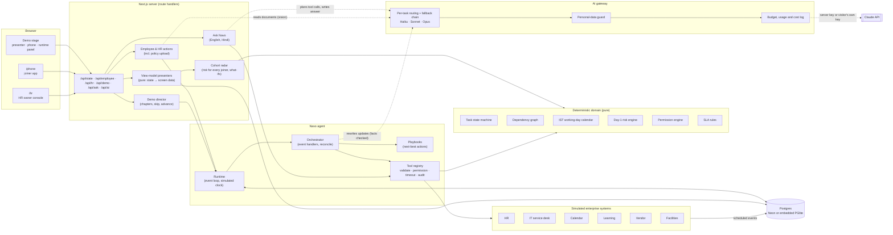
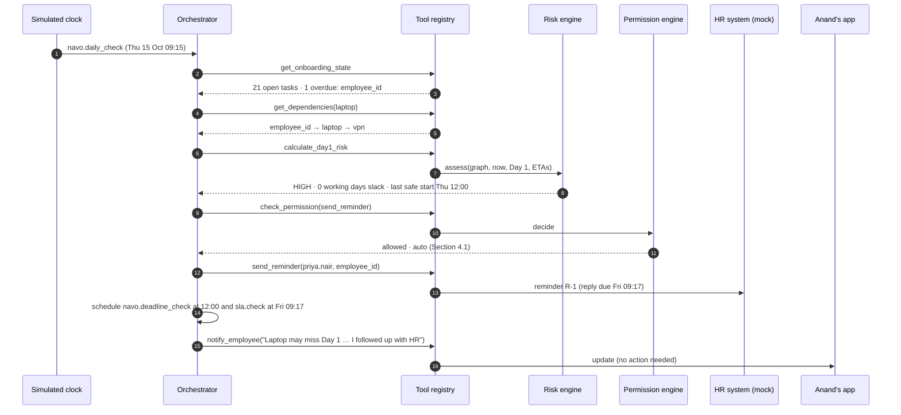
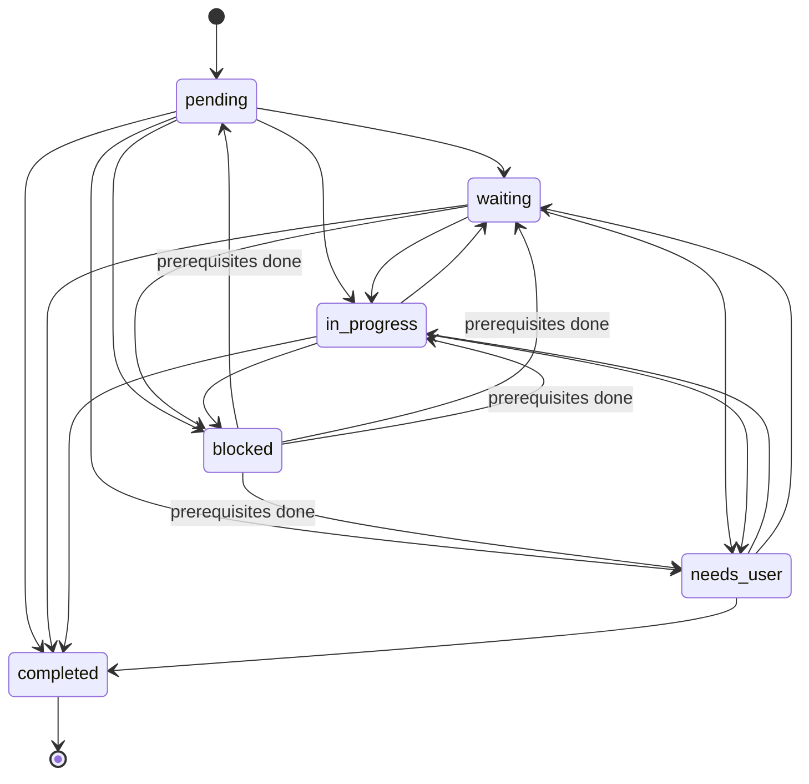
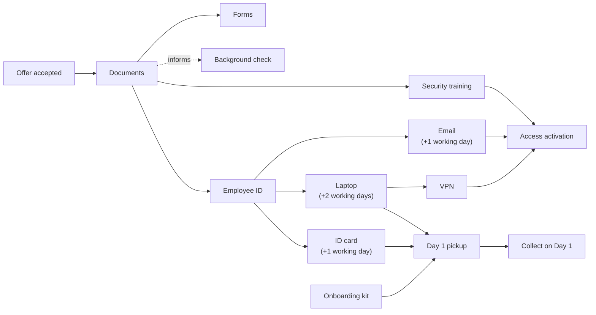
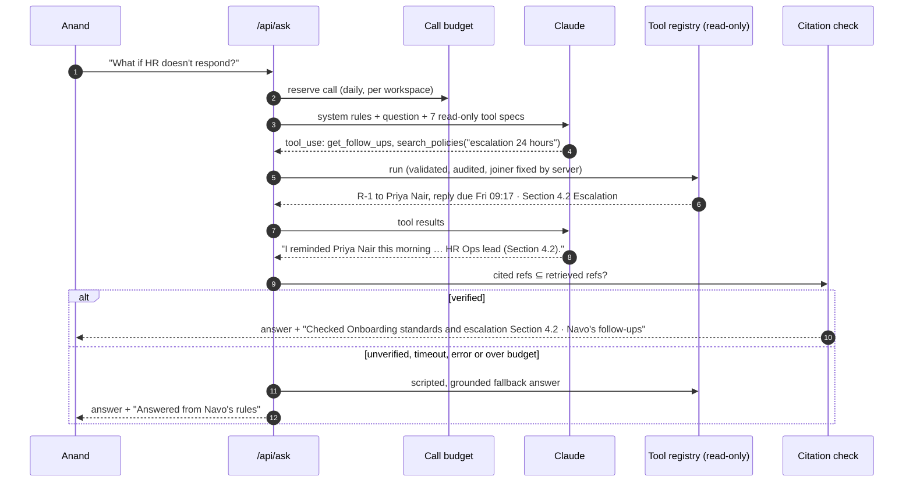
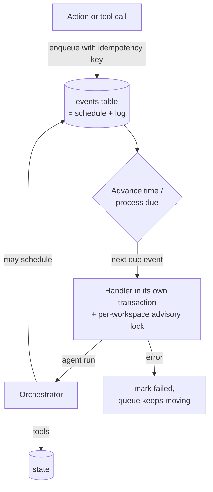
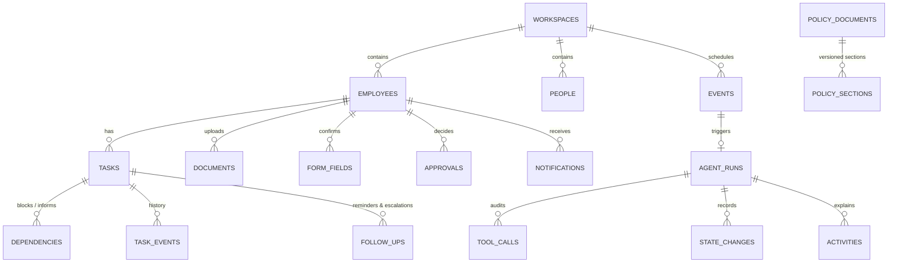
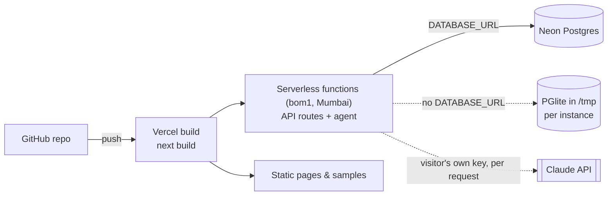

# Navo: Technical Design

**AI That Handles Onboarding.** A working prototype of an AI onboarding agent for Halden, a fictional company.

| | |
|---|---|
| Track | **Business Case #2: Employee Onboarding Companion** |
| Product | Navo, an onboarding agent for the joiner and the HR team |
| AI | Claude (Anthropic API) through one gateway: Haiku 5.5 for status updates, Sonnet 5.5 for Ask Navo, Opus 5.5 for documents, each with a fallback. Offline by default; visitors can bring their own key. |
| Stack | Next.js 16, React 19, TypeScript (strict), Postgres via Drizzle ORM, Vitest, Playwright |
| Data | Synthetic only. Halden, its people, policies, documents and systems are fictional. |

Related documents:
- [Enterprise architecture: built vs planned](ENTERPRISE_ARCHITECTURE.md)
- [Security and privacy (DPDP)](SECURITY_PRIVACY.md)
- [Cost model](COST_MODEL.md)
- [API reference](API.md)
- [AI quality benchmark](AI_QUALITY.md)
- [Load test](LOAD_TEST.md)
- [Architecture decision records](adr/README.md)

---

## Contents

1. [Project overview](#1-project-overview)
2. [System architecture](#2-system-architecture)
3. [How the agent works](#3-how-the-agent-works)
4. [Deterministic engines](#4-deterministic-engines)
5. [Where Claude is used, and how it is kept honest](#5-where-claude-is-used-and-how-it-is-kept-honest)
6. [Event-driven simulation and mock enterprise systems](#6-event-driven-simulation-and-mock-enterprise-systems)
7. [Data model](#7-data-model)
8. [User experience](#8-user-experience)
9. [Reliability, safety and privacy](#9-reliability-safety-and-privacy)
10. [Testing strategy](#10-testing-strategy)
11. [Setup](#11-setup)
12. [Deployment](#12-deployment)
13. [Code walkthrough](#13-code-walkthrough)
14. [Assumptions](#14-assumptions)
15. [Limitations and future work](#15-limitations-and-future-work)

---

## 1. Project overview

### The problem

A new joiner's first weeks depend on a chain of work spread across HR, IT, Facilities, a background-check vendor and the hiring manager. Each team tracks its own piece. Nobody owns the chain, so a late item upstream (an Employee ID, say) silently breaks things downstream (laptop, email, VPN, the Day 1 pickup). The joiner finds out on Day 1. HR finds out when the joiner complains.

### The idea

Navo is an agent that **owns the onboarding journey end to end**. It does not hand the joiner another checklist. It:

- **tracks** every onboarding task, its owner, deadline and dependencies;
- **reasons** about what blocks Day 1, using working-day lead times and explicit risk rules;
- **acts** within guardrails: reminds owners, raises IT and HR requests, books sessions and a single pickup, escalates after 24 hours without a reply;
- **asks first** before anything sensitive (an equipment change such as a loaner laptop, personal data, benefits);
- **explains** every action with the reason and the policy it relied on, to the joiner and to HR;
- **answers questions** from the joiner's live state and Halden's policy library, with citations.

### What the prototype demonstrates

The demo follows **Anand Mehta**, a Senior Product Manager joining Halden on **Monday 19 October 2026**:

1. **First launch.** He signs in and meets Navo, which states what it does alone and what it always asks first.
2. **Documents and forms.** Navo has already read most of his documents. It asks for one missing address proof, then asks about **one unreadable date** on his relieving letter (not the whole document). His forms come pre-filled; only the emergency contact needs him.
3. **Pre-joining: Navo at work.** On Thursday 15 October, Navo's daily check finds the **Employee ID 2 days late** with **zero working days of slack** for the laptop. It reminds HR on its own (Section 4.1), plans an escalation (Section 4.2) and a fallback.
   - *HR responds:* Priya in HR issues the ID from her console; Navo raises the laptop, email and ID-card requests within a minute.
   - *HR stays silent:* at the last safe moment Navo **asks Anand to approve a loaner laptop** (an asset change needs his OK), and escalates to the HR Ops lead after 24 hours.
4. **Ready for Day 1.** Navo books **one pickup** at Twin Tower, Building B for the ID card, laptop and kit.
5. **Day 1.** Navo runs the day and closes requests once Anand confirms what he collected (and follows up on anything he didn't).
6. **Week 1 to Day 30.** A health-cover deadline surfaces at the right moment, a walkthrough with his buddy is booked in a free slot, and the 30-day check-in is prepared.

Everything above runs on the **real engine**: a presenter can play it as a 3-minute guided demo, or explore freely.

### Who it is for

| Persona | What Navo does for them |
|---|---|
| **Joiner** (Anand) | One place that knows what's next, only asks for what genuinely needs them, and explains itself. |
| **HR owner** (Priya Nair) | A queue of exceptions instead of a spreadsheet of checklists; Navo has already chased what it can. A cohort radar shows every joiner's Day-1 risk and where it would break if a team slowed down. HR publishes policies that Navo cites straight away. |
| **IT, Facilities, managers** | Requests that arrive on time with the deadline and what depends on them. |

---

## 2. System architecture



### Design principles

- **Single agent, explicit tools.** One onboarding agent. Every action it takes goes through a tool registry that validates input, checks the permission engine, applies a timeout and writes an audit row. Nothing changes state "on the side".
- **Deterministic core, LLM at the edges.** State transitions, dependencies, working-day maths, risk thresholds and permissions are plain, unit-tested code. Claude understands and writes language, reads documents and plans read-only lookups. It never decides a state transition or a permission.
- **Event-driven world.** HR, IT, the vendor and Facilities are simulated systems that respond through scheduled events on a simulated IST clock. "Advance time" processes real events through the real engine, so the demo is reproducible and nothing is scripted UI.
- **Isolated workspaces.** Each visitor gets their own seeded copy of the Halden dataset (cookie-scoped), so judges exploring at the same time never see each other's changes.
- **Offline-first.** Every Claude feature has a deterministic fallback. The app, the demo and the whole test suite run without an API key. The hosted demo runs offline; a visitor can connect their own Claude key to see it live.
- **One door to the models.** Every Claude call goes through the AI gateway, which routes each task to the right-sized model, falls back on errors and refusals, masks personal numbers, enforces the budget and logs usage and cost.

### Request lifecycle (an employee action)

1. The phone calls `POST /api/employee` (validated with Zod).
2. The action runs in one transaction under a per-workspace advisory lock: it changes state through the domain rules and enqueues an `employee.action` event at the current simulated time.
3. The runtime processes every event now due. The orchestrator handles it in an **agent run**: it reads state, plans, and acts through tools, each audited.
4. The route returns a fresh **view model** built by a pure presenter.
5. The client replays the run's tool calls one by one in the runtime panel (and on Navo's face), then shows the new screen.

---

## 3. How the agent works

### Triggers

Navo wakes on events, never on a timer in the browser:

| Event | Source | What Navo does |
|---|---|---|
| `navo.daily_check` | Navo (09:15 each working day) | Reads state, assesses Day-1 risk, runs playbooks. |
| `navo.deadline_check` | Navo (at the last safe start it computed) | Re-checks the chain; offers a loaner if the driver will miss Day 1. |
| `sla.check` | Navo (24h after a reminder) | Escalates if the reminder is still unanswered. |
| `hr.employee_id_issued` | HR system | Completes the task, raises laptop/email/ID-card requests, tells the joiner. |
| `hr.id_card_printed`, `it.ticket_ready`, `it.ticket_delayed` | HR / IT | Updates tasks, re-plans, books the pickup when everything is ready. |
| `vendor.check_cleared`, `facilities.item_ready` | Vendor / Facilities | Updates tasks and dependencies. |
| `calendar.event_ended` | Calendar | Completes the linked task (e.g. the 1:1 happened). |
| `employee.action`, `employee.approval_decided` | The joiner | Reacts to uploads, forms, training, pickup confirmation, approvals. |

### One agent run

Every trigger becomes an **agent run** with an ordered list of tool calls and state changes. This is what the runtime panel shows.



### Playbooks: deciding what to do next

`src/agent/playbooks.ts` is a **pure function** from an onboarding snapshot to the actions Navo should take now. The same state always yields the same plan, which keeps the agent explainable and testable.

1. **Unblock:** start any blocked task whose prerequisites are now complete.
2. **Protect Day 1:** for overdue items on the critical chain of the riskiest Day-1 task:
   - medium risk → note that Navo is watching;
   - high risk → remind the owner (once);
   - reminder unanswered for 24h → escalate to the HR Ops lead (permission engine confirms the 24h);
   - the laptop will miss Day 1 → propose a loaner (needs the joiner's approval).
3. **After Day 1:** nudge the joiner about their own overdue items.
4. **Right moment:** open benefits enrolment 5 days before its deadline, with the relevant policy.

The orchestrator **reconciles**: it re-plans after acting, up to 8 passes, until nothing is left to do.

### Tool registry

22 tools, each with a guard level. The registry (`src/agent/tools/registry.ts`) validates input with Zod, consults the permission engine for acting tools, enforces a timeout (5s default) and writes a `tool_calls` audit row whether the call succeeds, fails, is denied or times out.

| Guard | Tools |
|---|---|
| `read` | `get_employee_context`, `get_onboarding_state`, `get_dependencies`, `calculate_day1_risk`, `search_policies`, `get_calendar`, `get_follow_ups`, `check_sla` |
| `policy` | `check_permission` |
| `auto` (permission-checked) | `send_reminder`, `escalate_owner`, `create_hr_request`, `create_it_request`, `schedule_meeting`, `schedule_pickup`, `enrol_training`, `update_task`, `notify_employee`, `notify_owner` |
| `approval` | `request_approval` |
| `event` | `on_event`, `on_approval` |

### Explanations

Each run records **activities** in four phases (Noticed → Decided → Acted → Planned/Reported) with simulated timestamps. They power the "Why?" view on the home screen, the Activity sheet, and HR's live feed, so every action has a reason the joiner can read:

> 09:15 **Noticed** Employee ID not issued. Due 13 Oct, owner HR.
> 09:16 **Decided** Laptop needs Employee ID + 2 working days. Today 12:00 is the last safe start. Day 1 at risk.
> 09:17 **Acted** Reminded Priya Nair, HR. Allowed automatically (Section 4.1).
> 09:17 **Planned** No reply in 24h → escalate to HR Ops lead (Section 4.2). No ID by 12:00 → offer you a loaner laptop.

---

## 4. Deterministic engines

All in `src/domain/`, pure (no I/O), with unit tests.

### Task state machine



A blocked task can only be unblocked once its blocking prerequisites are complete, and `completed` is terminal. Updates use optimistic locking (`version`) and write a `task_events` history row.

### Dependency graph

27 onboarding tasks joined by 29 edges. A `blocks` edge must be complete before the next task can start; an `informs` edge only shares information. The excerpt below is the Day-1 critical path. The graph answers: is this task eligible, what does it wait on, what does it unblock, what is its critical chain, and when could it finish at the earliest (projected through working-day lead times and any committed ETA from the owning system). Cycles are rejected.



### Working-day calendar

`src/domain/time.ts` works in IST with Halden's holidays. A request made **before 12:00** counts that day as the first working day of its lead time. It computes lead-time finish days, the **last safe start** for a deadline, and the next working time for scheduled checks. All business logic uses the workspace's simulated clock, never the wall clock.

### Day-1 risk rules

`src/domain/risk-engine.ts`. For each task required for Day 1:

| Level | Rule |
|---|---|
| **critical** | A miss is certain: even the best-case projection lands after Day 1. |
| **high** | Zero working days of slack, behind an overdue item on its critical chain. |
| **medium** | One working day of slack behind an overdue item. |
| **low** | More slack, or a tight but healthy chain with nothing overdue. |

A committed ETA from the owning system overrides upstream lateness. Overdue causes inherit the risk they cause downstream. The **driver** is the riskiest Day-1 task (ties: longest lead time), and the engine returns its last safe start. Once Day 1 begins, Day-1 risk closes and anything still open is simply overdue.

### Permission engine

`src/domain/permission-engine.ts` maps every action to an autonomy level and the policy section that allows it:

| Autonomy | Actions |
|---|---|
| Read (always) | reading state, dependencies, risk, policies, SLA |
| Auto | reminders, HR and IT requests, scheduling, pickup, training enrolment, task updates, notifications |
| Auto after 24h | `escalate_owner`, only when a reminder has gone 24 hours without a reply (Section 4.2) |
| Ask the joiner first | `request_loaner` (asset change), `update_personal_data`, `enrol_benefits` |
| HR only | `issue_employee_id`, `change_start_date` |
| Denied | anything not listed |

### SLA

Reminders carry a 24-hour reply window. `sla.check` events fire at the deadline; the follow-up becomes `breached` and the playbook escalates. When the owner replies, the reminder resolves and its pending checks are cancelled.

---

## 5. Where Claude is used, and how it is kept honest

Claude is used where language understanding genuinely helps. Each use has a **verification step** in code and a **deterministic fallback**.

| Feature | Model (fallback) | What Claude does | What code verifies | Fallback |
|---|---|---|---|
| **Ask Navo** | Sonnet 5.5 (Opus 5.5) | Plans which read-only tools to call, then writes the answer in Navo's voice, in English or Hindi. | Every policy ref it cites (e.g. Section 4.2) must have been returned by `search_policies` in this conversation; answer length and format. | Intent-matched answer built from live state and retrieved policy, through the same tools. |
| **Document reading** | Opus 5.5 (Sonnet 5.5) | Reads the uploaded image (vision) into named fields with a confidence each; unreadable characters come back as raw text with `?`. | Structured output parsed with Zod; deterministic rules decide verified / clarify / re-upload (name match, date window, confidence ≥ 0.8). | The recorded reading for the synthetic sample. |
| **Update writing** | Haiku 5.5 (Sonnet 5.5) | Rewrites Navo's template update so it reads naturally. | Every name, number, date and ticket from the facts must survive; no new numbers; no exclamation marks. | The template text. |

### The AI gateway

Every call goes through `src/services/llm/gateway.ts` ([ADR 0005](adr/0005-per-task-model-routing.md)):

1. **Route.** Each task has a model chain and an explicit effort level (`src/services/llm/models.ts`). Environment variables can pin a model per task (`NAVO_MODEL_ASK`, `NAVO_MODEL_NARRATE`, `NAVO_MODEL_DOCUMENTS`) or for all tasks (`NAVO_MODEL`).
2. **Guard.** For chat and narration, personal numbers are swapped for placeholders before the text leaves Navo, then swapped back in the reply. Covered: Aadhaar, PAN, phone, bank account, IFSC and email ([ADR 0007](adr/0007-personal-data-guard-scope.md)).
3. **Budget.** The call is reserved against the daily caps. The global cap applies to the deployment's key; the per-workspace cap applies to any key.
4. **Call and fall back.** The gateway moves to the next model in the chain on any of these: overload, a 5xx error, rate limiting, a model the key can't use, a dropped connection, or a refusal (`stop_reason: "refusal"`). It does not fall back on a timeout, a rejected key or a bad request. A fallback needs at least a second of the deadline left.
5. **Cache.** Ask Navo sets top-level prompt caching, so each round of the tool loop reads the previous round's prefix from cache.
6. **Record.** Each attempt is written to `llm_usage`: model, status, latency, input, output and cache tokens, key source, and masked counts by kind. The runtime panel shows it as calls, fallbacks, latency and estimated cost per task.

**Bring your own key.** The hosted demo runs with no server key ([ADR 0004](adr/0004-offline-first-bring-your-own-key.md)).
- A visitor can connect their own Anthropic key in the runtime panel. It is tested for free against the Models API and kept in the browser tab.
- The key is sent in the `x-navo-claude-key` header with Navo's own API calls. The server builds a client for that request only, and never stores or logs the key.

Measured cost: about **$0.07 per onboarding** at list price, half of what running every task on Opus would cost ([cost model](COST_MODEL.md)).

**Quality.** A benchmark of 17 Ask questions (3 in Hindi), the 3 documents and 6 status updates is graded by code. It runs offline in CI and live nightly when a key secret exists ([AI quality](AI_QUALITY.md)).

### Ask Navo flow



### Guardrails

- **Read-only tools for chat.** Ask Navo only exposes read tools; it cannot change state. The joiner id is fixed by the server, so a question can never read someone else's onboarding.
- **Prompt-injection resistance.** The system prompt tells Claude to ignore instructions in the question; unknown tool names return an error to Claude and nothing runs; tests cover an injection attempt.
- **Budget.** Every Claude call is reserved in `llm_usage` before it is made (global daily cap and per-workspace cap). Over budget → fallback.
- **Deadlines.** Ask has a whole-answer deadline (25s); in-flight work is aborted when it passes. Document reading and narration have their own timeouts.
- **Model choice.** Per task through the gateway (above). Ask, reading and narration use low effort for latency; tool choice stays automatic.
- **Languages.** A question in Hindi (Devanagari) gets a Hindi answer: the rule-based fallback has Hindi versions of every answer, and retrieval maps common Hindi words to the English policies. Claude is told to answer in the question's language.

---

## 6. Event-driven simulation and mock enterprise systems

The world around Navo is simulated but behaves like real systems: it responds **later**, through scheduled events.



- **Events table = schedule + log.** Each event has a due time, a status (`scheduled`, `processed`, `ignored`, `failed`, `cancelled`) and a unique idempotency key, so duplicate deliveries never run twice.
- **Simulated IST clock.** Each workspace has its own `simNow`. "Advance time" jumps to the next event and keeps going until something the joiner would notice happens (quiet daily checks don't need a click each).
- **Mock systems** (`src/mock-systems/`): HR (issues the Employee ID after a delay in the "HR responds" scenario, prints the ID card), IT (lead times per ticket type, loaners from stock, injected delays), Calendar (bookings that complete tasks when they end), Learning, the background-check Vendor and Facilities.
- **Scenarios.** The presenter can switch how HR behaves: **HR responds** (replies 86 minutes after the reminder) or **HR silent** (never replies; HR Ops issues the ID 92 minutes after the escalation).
- **Moot events are cancelled.** When HR replies, the reply-window check and the last-safe-start re-check are cancelled rather than left in "Up next".

---

## 7. Data model

28 tables (Drizzle schema in `src/lib/db/schema.ts`, migrations in `drizzle/`). Every workspace-scoped row cascades on workspace delete, so Reset rebuilds a clean copy.



| Group | Tables |
|---|---|
| Workspace and people | `workspaces`, `people`, `employees` |
| Onboarding state | `tasks`, `dependencies`, `task_events`, `documents`, `form_fields`, `approvals`, `follow_ups` |
| Agent audit trail | `events`, `agent_runs`, `tool_calls`, `state_changes`, `activities`, `notifications` |
| Knowledge | `policy_documents`, `policy_sections` (versioned; superseded versions are filtered out; HR uploads are scoped to a workspace and can replace a library policy with a newer version) |
| Simulated systems | `hr_requests`, `it_tickets`, `calendar_events`, `training_enrollments`, `vendor_checks`, `facilities_items`, `benefit_enrollments`, `pulse_responses`, `counters` |
| Operations | `llm_usage`: one row per Claude attempt, with model, status, latency, tokens, cache tokens, key source and masked counts |

**Policy retrieval** (`src/services/policy-retrieval/`) is BM25 with stemming, stop words and synonyms over the current version of each policy section, with a minimum relevance score: below it, Navo says it doesn't know instead of guessing. A superseded hybrid-work policy (v2.0, "no remote Fridays") is seeded deliberately; answers use v2.1.

**Policy upload** (`src/services/policy-retrieval/upload.ts`). HR pastes text or uploads a `.md` or `.txt` file.
- **Splitting:** Navo splits it by Markdown headings, numbered headings or paragraphs, and cuts long sections at sentence boundaries.
- **Refs:** a new policy gets the next free number (`Section 9.1`…); a newer version keeps its policy's number, so refs never collide.
- **Publishing:** HR previews the sections first. Published sections are searchable at once, and a future effective date keeps them out until then.

---

## 8. User experience

The design follows the HTML prototype in `docs/design/Navo_Prototype.dc.html`.

- **Demo stage (`/`)**: presenter panel (chapters, HR scenario switch, Advance time, Reset, IT delay, "Up next" from the real event queue), the joiner's phone, and the **agent runtime panel**, which replays Navo's actual tool calls with guard badges, then the state changes they caused.
- **Joiner app**: 20 screens: launch, sign-in, meet Navo, documents (sample upload), privacy, clarify, forms, home, culture, Employee ID tracker, journey, updates, ID card, pickup, Day 1 plan, pickup confirmation, Day 1 wrap-up, week 1, benefits, Day 30. Plus the Activity sheet ("What Navo did", with reasons) and the Ask Navo sheet.
- **Navo's face** has nine states (watching, thinking, acting, concerned, needs you, celebrating…) and follows the tool running during a replay.
- **HR owner console (`/hr`)** has three pages, with Navo's live activity on the featured joiner beside them:
  - **Needs HR:** exceptions only, with what Navo already did. "Generate ID" is the one HR action in the story.
  - **All joiners:** the cohort radar. Every joiner's Day-1 risk from the real risk engine, the teams whose tasks break a Day 1, and what-ifs such as "IT takes a week longer" that mark the joiners who would change.
  - **Policies and rules:** the library with versions and status, and adding or updating a policy.
- **AI panel** (in the runtime panel): which model handles each task and its fallback, live usage and estimated cost, personal numbers masked, and the "Try it with your own Claude key" dialog.
- **Guided demo**: 29 beats that drive the real API end to end in about 3 minutes (including a late laptop that Navo re-plans around, asking Anand before it reserves a loaner), with captions computed from the resulting state; keyboard: → next, ← back, Space play/pause, H HR view, B brief, Esc close.
- **Impact screen**: figures computed from the run (tasks closed, days before Day 1 the risk was acted on, follow-ups sent, things that needed the joiner, audited tool calls).
- **Hindi**: Ask Navo answers questions asked in Hindi, and offers a Hindi suggestion.
- **Accessibility**: WCAG 2.1 AA colour contrast, labelled regions and dialogs, keyboard operation, focus rings, `prefers-reduced-motion` respected. Axe scans cover every HR page and the key dialog.

---

## 9. Reliability, safety and privacy

| Concern | How it is handled |
|---|---|
| Concurrent requests | Each event runs in its own transaction under `pg_advisory_xact_lock(workspace)`. Task updates use optimistic locking. |
| Duplicate events | Unique idempotency key per event; handlers also ignore duplicates (e.g. an ID issued twice). |
| A failing handler | Its transaction rolls back, the event is marked `failed` with the error, and the queue keeps moving. |
| Invalid tool input | Zod validation; the failure is audited and surfaced, not swallowed. |
| Slow tools | Per-tool timeout (5s default), audited as `timeout`. |
| Unsafe actions | Permission engine: asset changes and personal data need the joiner's approval; Employee IDs and start dates are HR-only; unknown actions are denied. |
| LLM errors, slowness, cost | A fallback model on overload, rate limits and refusals; deadlines and aborts; a daily call budget; deterministic fallbacks for every Claude feature. Even when the fallback itself can't read the state (for example a tool timeout under load), Ask answers honestly instead of failing. |
| Personal data and AI | Personal numbers are masked before chat and narration reach the model; visitor keys stay in the browser tab and are never stored or logged (tested). See [security and privacy](SECURITY_PRIVACY.md). |
| A pushy agent | Navo asks about a loaner once; a "no" stands. HR can't issue an Employee ID that is still blocked. |
| Hallucinated policy | Citations must match retrieved sections; low-relevance questions get "I don't know". |
| Privacy | Synthetic data only. Documents are used only for onboarding (Section 8 of the document-handling policy). The demo's sample images are rendered locally and watermarked "SYNTHETIC SAMPLE". API keys live in environment variables or, for visitors, in their own browser tab; never in code. |

---

## 10. Testing strategy

| Layer | Tool | What it covers | Count |
|---|---|---|---|
| Unit | Vitest | Working-day calendar, state machine, dependency graph, risk engine, cohort radar, permission engine, SLA, policy retrieval, document verification, free-slot finder, model routing and pricing, the personal-data guard, IT lead times, radar copy, product-video timeline | 15 files |
| Property-based | fast-check (in the unit suite) | Hundreds of random cases per rule. **Working days:** adding n working days lands on a working day. **Dependency graphs:** random graphs are always ordered, projections never run ahead of a prerequisite, and loops are rejected. **What-ifs:** slowing a team never lowers anyone's risk. **Guard:** text round-trips exactly with no personal number sent. | 8 properties |
| Integration | Vitest + in-memory PGlite | **Agent:** both golden paths through the real engine; a journey sweep checking every screen at every step for broken copy and backwards chapters. **Reliability:** invalid input, timeouts, denials, conflicts, duplicate and failing events. **Ask Navo:** the Claude tool loop, unverified citations, refusals, injection, the budget, every fallback state in English and Hindi. **AI gateway:** routing, fallback chain, caching, guard, budgets. **Visitor keys:** the key is never stored or logged. **Also:** policy upload and versioning, the cohort radar, API error mapping, the AI benchmark. | 18 files |
| Component | Testing Library + jsdom | Every phone screen in 7 real engine states (built before the run), the HR console's three pages, the runtime and presenter panels, the client store (replay, Ask, errors, the visitor key header), the AI panel and key dialog, the policy page and the radar | 6 files |
| End-to-end | Playwright (production build, offline mode) | **Journeys:** first launch to blocker cleared, HR silent with the loaner, the full guided demo to the impact screen. **Features:** Ask Navo (English and Hindi), connecting a visitor key, publishing a policy and asking about it, the cohort radar what-if. | 8 specs |
| Accessibility | Playwright + axe-core | WCAG 2.1 A/AA scans of the intro, stage, phone, every HR page and the key dialog; keyboard shortcuts | 6 tests |
| AI quality | `npm run eval` | 17 Ask questions (3 in Hindi), 3 documents, 6 status updates, graded by code; offline in CI, live nightly with a key | [AI_QUALITY.md](AI_QUALITY.md) |
| Load | `npm run load-test` | 50 visitors running a full journey at once; fails on any error or cross-visitor leak | [LOAD_TEST.md](LOAD_TEST.md) |

**Results:**
- **264** unit, integration and component tests pass.
- **13** end-to-end tests pass, both on embedded PGlite and on real Postgres 16.
- The load test made 350 requests on Postgres with 0 errors.

**Coverage** (UI included), with floors in `vitest.config.ts` that CI enforces:

| Scope | Lines | Branches |
|---|---|---|
| Overall | 90.8% | 79.8% |
| Server code | — | 85.1% |
| Domain rules | — | over 90% |

**CI** (GitHub Actions) runs these jobs:
- **Checks:** lint, typecheck, tests with coverage, the offline AI benchmark, build.
- **Dependency audit:** fails on high or critical advisories in production dependencies.
- **End-to-end:** on PGlite.
- **Real Postgres 16:** migrations, the end-to-end suite and the 50-visitor load test.
- **Nightly:** the live AI benchmark, which runs only when a key secret is set.

Writing these tests found and fixed real bugs:
- Navo re-asked about a declined loaner at every event.
- The SDK rejected a fractional request timeout.
- Ask returned a 500 when a tool timed out under load.
- HR could issue an Employee ID that was still blocked.
- Two weak offline answers.
- A label that swallowed its hint.

---

## 11. Setup

### Prerequisites

- Node.js 22 and npm
- No database setup: locally Navo uses an embedded Postgres (PGlite) stored in `.data/`.

### Run locally

```bash
git clone https://github.com/KumarAnandSingh/new.git navo && cd navo
npm ci
cp .env.example .env.local     # optional: add ANTHROPIC_API_KEY for live Claude features
npm run dev                    # http://localhost:3000
```

- `/` demo stage with the guided demo · `/phone` the joiner's app · `/hr` the HR console.

### Configuration

| Variable | Default | Purpose |
|---|---|---|
| `ANTHROPIC_API_KEY` | (empty) | The deployment's own key. Without it Navo runs offline, and visitors can bring their own key. |
| `NAVO_MODEL` | (routed) | Pins every task to one model; the default chain still backs it up. |
| `NAVO_MODEL_ASK`, `NAVO_MODEL_NARRATE`, `NAVO_MODEL_DOCUMENTS` | (routed) | Pins one task's model. |
| `NAVO_BYOK` | (on) | `off` stops visitors connecting their own key. |
| `NAVO_DB_POOL_MAX` | `10` | Postgres connections per server instance. |
| `DATABASE_URL` | (empty) | Postgres connection string (e.g. Neon). Empty → embedded PGlite. |
| `NAVO_DAILY_LLM_CALL_LIMIT` | `400` | Daily cap on calls made with the deployment's own key. |
| `NAVO_WORKSPACE_DAILY_LLM_CALL_LIMIT` | `80` | Daily cap per visitor workspace, on any key. |
| `NAVO_LIVE_AI` | (empty) | Set to `off` to force offline mode even with a key. |
| `NAVO_ASK_TIMEOUT_MS` | `25000` | Ask Navo deadline before the scripted answer is used. |

### Quality gates

```bash
npm run lint        # ESLint (Next.js + TypeScript rules)
npm run typecheck   # tsc --noEmit (strict)
npm test            # unit, integration, property and component tests
npm run test:coverage
npm run eval        # AI quality benchmark (offline); add -- --live with a key
npm run build
npm run test:e2e    # Playwright, against the production build
npm run load-test -- --base http://localhost:3000 --visitors 50
npm run cost-model  # estimated Claude cost per onboarding
```

---

## 12. Deployment



1. Import the GitHub repository into Vercel (framework: Next.js, no build settings to change).
2. No API key is needed: the demo runs offline, and visitors can connect their own key. To run live for everyone, set `ANTHROPIC_API_KEY` (the daily caps protect it).
3. Recommended: add **Neon Postgres** from Vercel Storage and connect it to the project; it sets `DATABASE_URL`. Migrations in `drizzle/` are applied automatically on first connection (or ahead of time with `DATABASE_URL=… npm run db:migrate`).
4. Deploy. Production URLs are public; preview URLs may require a Vercel login.

Without `DATABASE_URL` the hosted demo still works: each serverless instance keeps an embedded database in its temp directory, and a visitor on a fresh instance simply gets a fresh workspace. `next.config.ts` traces the migrations, PGlite's WASM build and the sample images into the functions; `vercel.json` pins the functions to `bom1` (Mumbai).

---

## 13. Code walkthrough

```
src/
├── domain/            Pure business rules (no I/O): time, state machine, dependency graph,
│                      risk, cohort what-ifs, permissions, SLA, scheduling
├── eval/              AI quality benchmark: golden cases, graders, runner
├── agent/             The onboarding agent
│   ├── orchestrator.ts    Routes each event to its handler
│   ├── handlers.ts        One handler per event type
│   ├── reconcile.ts       The reconcile loop (one agent run per trigger) and run helpers
│   ├── playbooks.ts       Pure next-best-action planner
│   ├── actions/           Executes planned actions (start a task, remind, escalate, propose loaner, nudges)
│   ├── snapshot.ts        Loads everything the planner needs, with ETAs from owning systems
│   ├── runtime.ts         Event loop: process due events, advance the simulated clock
│   ├── context.ts         Agent run context: runs, activities, state changes, notifications
│   ├── narration.ts       Template updates in Navo's voice
│   ├── claude-narrator.ts Claude rewrite with fact checks
│   └── tools/             Registry (validate, permission, timeout, audit) and 22 tools: read, act, schedule, state
├── services/
│   ├── ask/               Ask Navo: Claude tool loop, citation verification, scripted fallback
│   ├── documents/         Document verification rules, fixture reader, Claude vision reader
│   ├── llm/               AI gateway: routing, fallback chain, guard, budget, usage, key check
│   ├── policy-retrieval/  BM25 search over versioned policy sections, and HR policy upload
│   ├── cohort/            Loads every joiner's graph for the cohort radar
│   ├── events/            Event queue (idempotent enqueue, cancel, upcoming)
│   ├── onboarding-state/  Task repository with optimistic locking
│   ├── workspace/         Seeding, reset, isolated workspaces
│   ├── view-model/        Loads state; presenters/ turns it into every screen's data (pure)
│   ├── employee-actions.ts  What the joiner and HR do in the app
│   └── demo-director.ts   Chapters, skip-ahead, "Advance time" for presenters
├── mock-systems/      Simulated HR, IT, calendar, learning, vendor, facilities
├── content/           Synthetic Halden data: people, 27-task template, policies, documents, timeline
├── lib/db/            Drizzle schema and database client (Neon or PGlite)
├── server/            Session cookie, dependency wiring, response helpers
├── ui/                React components: phone screens, demo stage, HR console (queue, radar,
│                      policies), AI panel and key dialog, NavoFace, client store
└── app/               Next.js routes and API route handlers
tests/
├── unit/              Domain rules and services
├── integration/       Agent, scenarios, journey sweep, reliability, Ask Navo, gateway (in-memory Postgres)
├── components/        Screens and panels rendered from real engine state (jsdom)
└── e2e/               Playwright journeys, features and accessibility
video/                 The product video: storyboard (story.ts), timeline, browser composer,
                       voice-over script; rendered by scripts/video/ (npm run video)
docs/
├── TECHNICAL_DESIGN.md   This document
├── ENTERPRISE_ARCHITECTURE.md, SECURITY_PRIVACY.md, COST_MODEL.md, API.md
├── AI_QUALITY.md, LOAD_TEST.md
├── adr/                  Architecture decision records
├── DEMO_VIDEO_SCRIPT.md  Script for the demo video
├── specs/                Product, agent, architecture, data, testing and demo specs
└── design/               The HTML prototypes the UI implements
```

### Key files to read first

| File | Why |
|---|---|
| `src/agent/reconcile.ts` | How every trigger becomes an agent run. |
| `src/services/llm/gateway.ts` | The one door to Claude: routing, fallbacks, guard, budget, usage. |
| `src/agent/playbooks.ts` | The decision logic, as a pure function. |
| `src/agent/tools/registry.ts` | The guardrail every action passes through. |
| `src/domain/risk-engine.ts` | The Day-1 risk rules. |
| `src/domain/permission-engine.ts` | What Navo may do alone, what it asks first, what it never does. |
| `src/services/ask/index.ts` | Claude tool use with citation verification and fallback. |
| `tests/integration/scenario-hr-silent.test.ts` | The whole "HR silent" story as a test. |

### Conventions

- Strict TypeScript (`noUncheckedIndexedAccess`), Zod at every boundary, typed errors mapped to HTTP status codes in one place.
- Business logic uses the workspace's simulated IST clock, never `Date.now()`.
- Schema changes: edit `src/lib/db/schema.ts`, then `npm run db:generate`.

---

## 14. Assumptions

**Prototype**

1. HR, IT, calendar, learning, vendor and facilities systems are mocked; they respond through scheduled events with realistic delays.
2. All company, employee, task, document and policy data is synthetic. Halden and Northwind Freight are fictional; sample documents are rendered locally and watermarked.
3. The demo calendar is real 2026 dates in IST: Day 1 is Monday 19 October 2026; Halden observes 2 Oct and 25 Dec as holidays.
4. Authentication is simplified to an anonymous, cookie-scoped workspace per visitor; sign-in screens are illustrative.
5. Notifications and emails are recorded in the app, not sent externally.

**Business rules** (from Halden's synthetic policy library)

- HR issues the Employee ID within 4 working days of documents being verified (Section 4.0).
- A laptop needs the Employee ID plus 2 working days; a request before 12:00 counts that day (Section 5.1).
- Email accounts take 1 working day; email, VPN and tools switch on at 09:00 on Day 1 once security training is done (Section 5.2, Section 7.1).
- Navo may remind owners automatically (Section 4.1) and escalate after 24 hours without a reply (Section 4.2).
- Asset changes such as a loaner laptop need the joiner's approval (Section 4.2, Section 5.3).

**AI**

- The LLM is not an authority for business rules, dates or permissions; deterministic code is.
- Policy answers are grounded in the policy library and cite the sections they used.
- Sensitive actions require human approval; every action is recorded for audit.

---

## 15. Limitations and future work

**Limitations (disclosed)**

- No real HRIS, ITSM, calendar or learning integrations; no production identity or access management.
- One featured joiner is fully simulated. The other 13 are seeded with realistic task states; the cohort radar runs the real risk engine on them, but the agent doesn't run their stories.
- Hosted without `DATABASE_URL`, workspaces last only as long as a serverless instance.
- Prototype-level observability. Figures on the impact screen come from the simulated run, not production measurement.
- No live AI numbers are published: this project spends no money on the API. The benchmark and cost model are ready to run with a key.
- Under a burst of 50 simultaneous visitors one Node process queues requests (see the [load test](LOAD_TEST.md)); a production deployment scales out.

**Next steps**

1. Connectors for real systems (HRIS, IT service management, calendar and learning platforms) behind the same tool interfaces.
2. SSO and role-based access for joiners, HR, IT and managers.
3. Run the agent for every joiner, not just the featured one, and trend the cohort radar over time.
4. PDF and DOCX policy ingestion, and a hybrid vector index alongside BM25 at larger scale.
5. Notification channels (email, chat) with the same fact-checked narration, in Hindi and more Indian languages.
6. SSO, role-based access and the DPDP controls listed in [security and privacy](SECURITY_PRIVACY.md).
